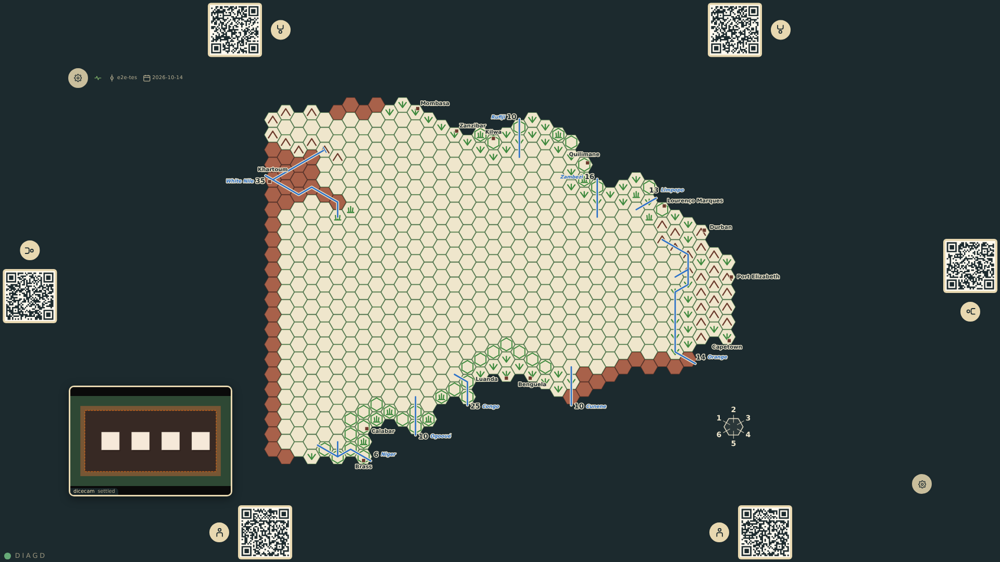

# Dice consumed

The table writes every throw that enters the game to the diagnostics capture as a dice/consumed line (prompt 57): the seat, how the values came (the dicecam, a tapped face, the table rolling the rest), the engine's name for the throw, each die's face and place in the picture with how surely it was read, the dice left lying in the tray, what the table ignored as the tray as it lay, whether the engine saw anything move since the last throw was taken, and what the throw is for (the held event, the ask's words, how many dice). The offline check, bun run diag:dice, reads the lines back and tells a die consumed twice: a die taken at the place of a die taken before while nothing moved in the tray is the same die, whatever face the engine read this time. The scenario stands in for the capture server, plays the roll for first player with the dicecam, and then lets the engine misread one of the four dice still lying from that throw while the next seat's ask is open: the table takes the four dice again, as it did at the user's table on the 17th, and the check names each of them.

_Generated by the test step helper from `041-dice-consumed.spec.ts`. Do not edit by hand._

## 1. The table is opened against the capture server (answered by the scenario) with physical dice switched on: the status line's capture dot is up, and the capture already holds the dice/physical event and the dicecam coming up

**Player**

**Verifications:**

- [x] The status line shows the capture up; the capture has the event appended and the dicecam's status, and nothing consumed yet

## 2. bottom-1 throws four sixes for first player and the dicecam reads them twice over: the throw is in, shown at bottom-1's station, and the capture has one dice/consumed line for it: four sixes with their places and surety, the four twos the table ignored as the tray as it lay, the dice seen moving, for the roll for first player

**Player**

**Verifications:**

- [x] The capture line names the seat, the source, the throw, each die's face, place and surety, what was ignored, that the dice moved, and what the throw is for
- [x] The line comes after the reading that took the throw and before the throw appended and the next ask; the health check finds one throw and nothing re-used

## 3. Nothing moves in the tray, but the engine misreads the first of bottom-1's dice as a one while top-1's ask is open: the table takes the four dice lying there as top-1's throw, 1 6 6 6, the roll for first player is decided, and the capture shows what happened: a second dice/consumed line with the same four places, nothing moved since the last throw, and the health check names every one of the four dice as re-used

**Player**

**Verifications:**

- [x] The second line is top-1's, the same roll id and the same four places, no motion since the throw before
- [x] The offline check reads the lines back: two throws, four dice RE-USED where the dice taken before lay, nothing moved; the first of them read as a 1 where a 6 lay
- [x] At the table the roll for first player is decided on the dice as read: bottom-1 24, top-1 19, bottom-1 first
