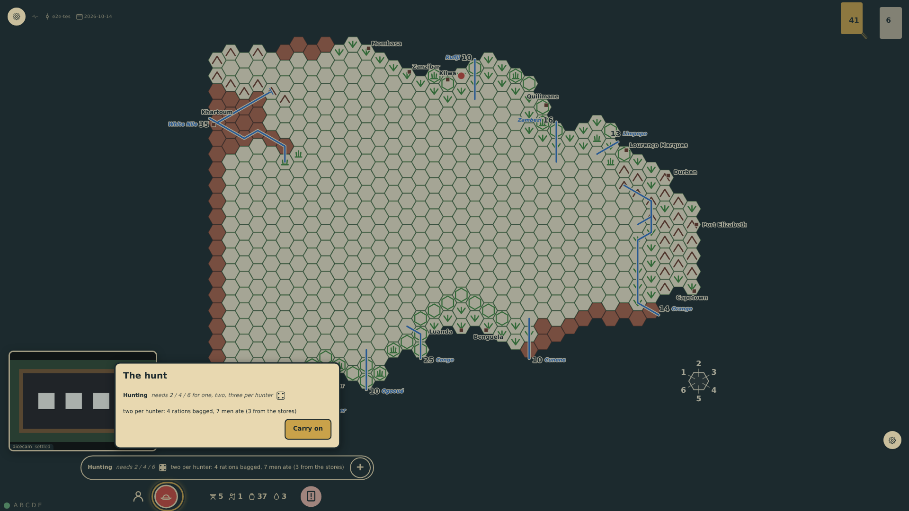
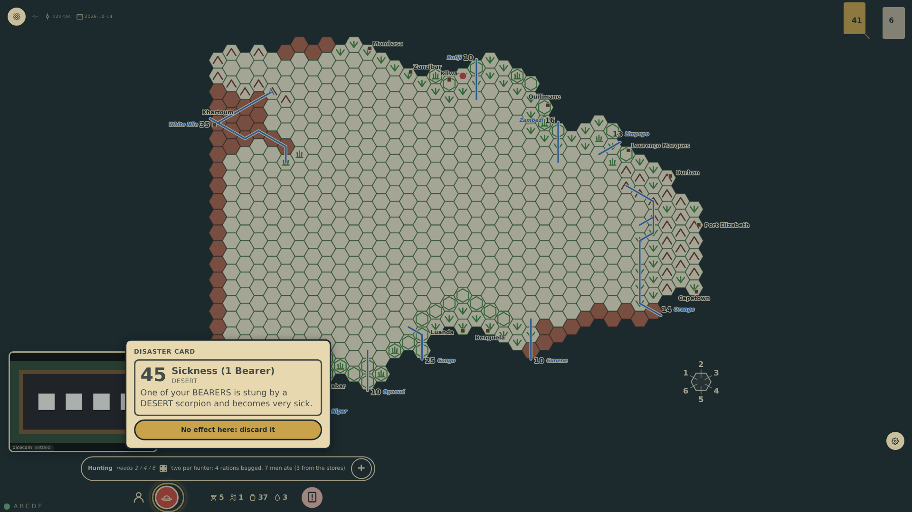

# One player at the table

A game may be played by one explorer alone. Every turn is then the same seat's, so when a turn in the field ends and the hunt's die is in, the next turn opens at once at the same edge, on its disaster card. The card waits (prompt 64): the hunt's result stands alone for two seconds, or until Carry on is tapped, and the card is shown when it goes. The E2E build holds the result until the tap.

_Generated by the test step helper from `042-one-player.spec.ts`. Do not edit by hand._

## 1. The turn ends on the veldt south of Kilwa and the hunting die is in: the next turn is already bottom-1's again, standing at its disaster card, but the table shows only the hunt's result at the edge, the card waiting behind it

**Player**

**Verifications:**

- [x] The result panel is titled The hunt; no disaster card is shown though the turn stands at one, for the same seat

## 2. Carry on (or two seconds at the table) takes the result away, and the disaster card the next turn stands at is shown at the same edge; nothing in the game changed meanwhile

**Player**

**Verifications:**

- [x] The disaster card is shown for bottom-1 with its control, the result is gone, and no event passed between
