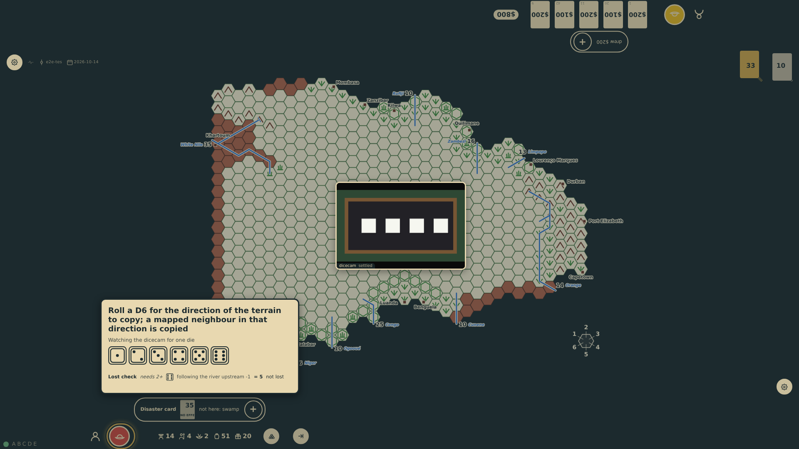
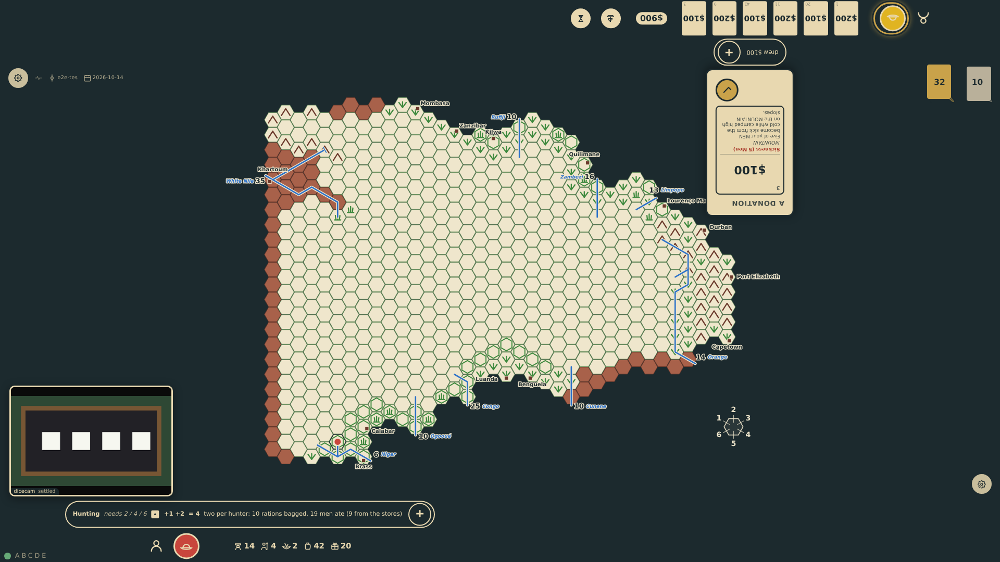

# An explored hex

With physical dice the table asks for each die of a step into a blank hex: the lost check, the direction of the terrain to copy, the terrain. What the dice have already decided for the step stands at the foot of the ask, below the faces, each line with its verdict, the lost check's reading "not lost" (prompt 65). When the last die is in and the expedition still has movement points, the result does not go by itself: it stays at the edge, reading "Explored a jungle hex" and, as the prompt to move does (prompt 74), "You have 1 MP: pick a hex to move into, or END TURN", the last words the control that ends the turn, the board open for the next step.

_Generated by the test step helper from `043-explored-hex.spec.ts`. Do not edit by hand._

## 1. The lost check is in and the direction die is asked: the ask and the faces stand first, and the lost check's line, its die and "not lost", stands at the foot of the panel

**Player**

**Verifications:**

- [x] The line so far reads not lost and lies below the faces

## 2. The last die is in and the hex is mapped as jungle with a point to spare: the result stays at the edge without holding the table, headed Explored a jungle hex, prompting for the next hex with the point left, or END TURN, the lines decided at its foot; the board shows the next targets

**Player**

**Verifications:**

- [x] The panel reads Explored a jungle hex with the prompt to move and its END TURN control, no Carry on, no scrim; the lines stand below; the board offers targets

## 3. End in the panel ended the turn: the hunt was rolled and read, and the turn is top-1's; bottom-1's log holds the step's lines and the meal

**Player**

**Verifications:**

- [x] The turn passed to top-1; bottom-1's turn holds the card, the lost check (not lost), the terrain, the river, the natives and the hunt
