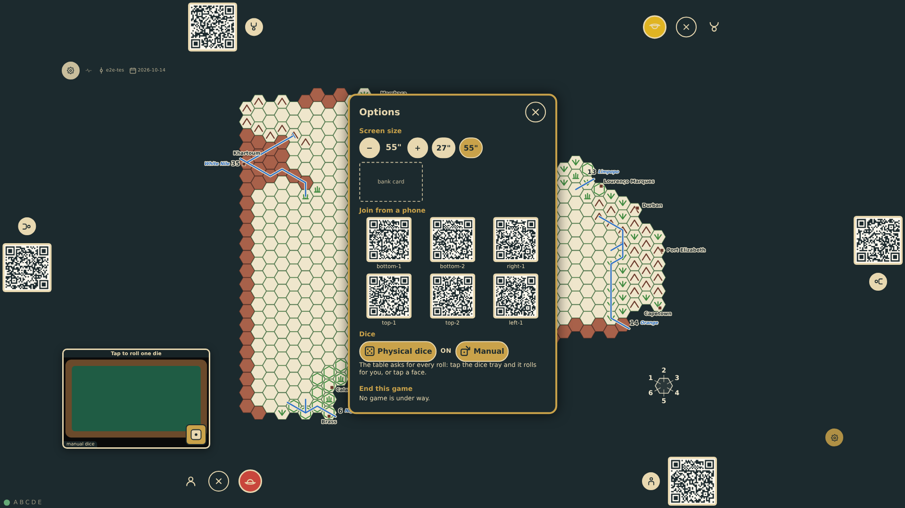
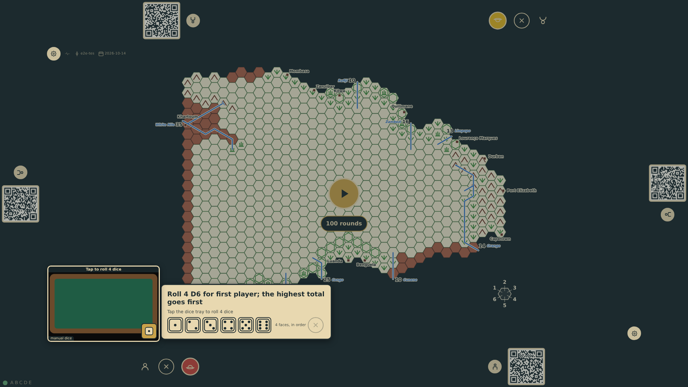
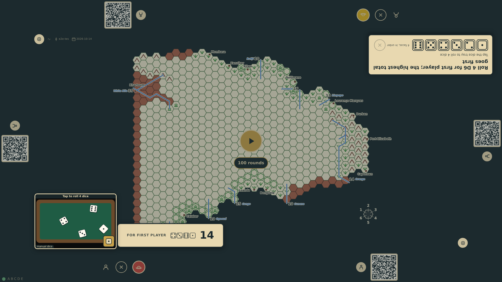
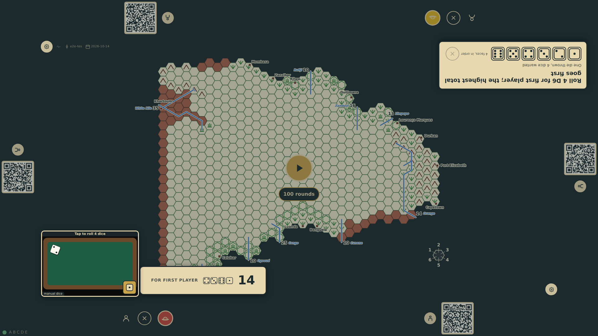
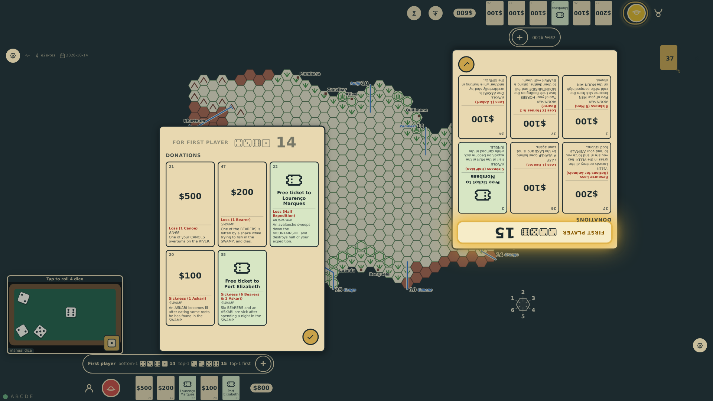

# Manual dice

The options screen has a second dice control, Manual (prompt 66), for a table without a camera and for trying the game out quickly. It switches physical dice on, so the table asks for every roll, and puts a dice tray the table draws in the south-west corner of the board, where the dicecam's picture is parked: no camera is asked for, and the tray stays in that corner whoever rolls (prompt 67). A tap on the tray throws the dice the table is asking for, made up by the table; the die button in its corner tosses in one die at a time. The tray speaks for the dicecam's engine in the engine's own messages, so each throw is judged, recorded with where its dice lay and shown exactly as a throw the camera read.

_Generated by the test step helper from `044-manual-dice.spec.ts`. Do not edit by hand._

## 1. The options screen's dice section has a Manual control beside Physical dice: switched on, physical dice go on with it, and a dice tray appears in the south-west corner of the board where the dicecam would be

**Player**

**Verifications:**

- [x] Both controls are on, the note says a tap on the tray rolls, and the game records physical dice
- [x] The tray is empty and offers a roll of one die; no camera picture is shown

## 2. The game is started and the table asks bottom-1 for four dice for first player: the tray stays in its corner, lit above the held table, and offers a roll of the four dice wanted

**Player**

**Verifications:**

- [x] The ask names four dice, the status line says to tap the tray, and the tray offers four

## 3. One tap on the tray throws four dice, which land in it; the table takes them as bottom-1's roll, shown at its station, and asks top-1 for its four, the tray where it was

**Player**

**Verifications:**

- [x] The throw entered the game as a dice/rolled event with the tray's four faces, left to right, and where each die lay
- [x] bottom-1's station shows its roll; top-1 is asked, and the dice lying in the tray are not taken for its throw

## 4. The die button in the tray's corner picks up the dice lying from the last roll and tosses in a single die: the table sees one die thrown of the four it wants and waits

**Player**

**Verifications:**

- [x] One die lies in the tray, the status line counts it, and nothing more has entered the game

## 5. Three more dice tossed in one at a time make top-1's four: the table takes them, the roll for first player is decided and each station shows its roll

**Player**

**Verifications:**

- [x] top-1's throw is the four dice in the tray, and the game holds both rolls and who goes first
- [x] Both stations show their roll, and the tray is still in its corner offering the next roll
