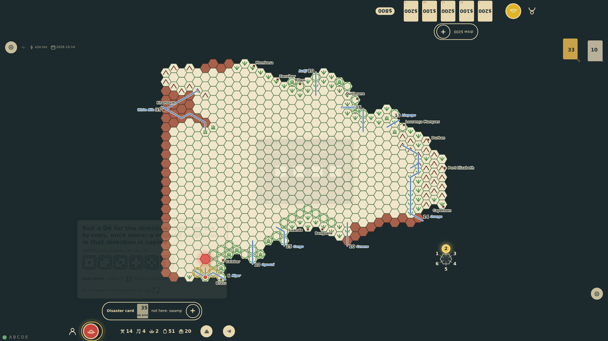
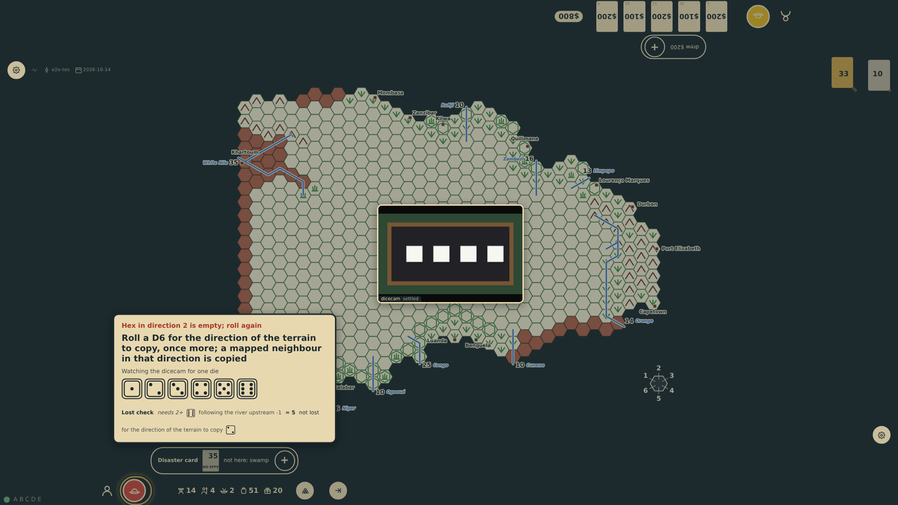

# The terrain's direction on the board

A blank hex takes its terrain from the neighbour in a direction rolled (rules §7.3). After the die the board plays it out (prompt 68): the digit rolled glows on the compass in the sea off Capetown, then the neighbour that way glows, then its terrain is copied into the hex explored. A neighbour with nothing mapped glows red and fades, and as it fades the dice panel says "Hex in direction 2 is empty; roll again". Each phase stands for 700 ms at the table; this scenario holds each and steps it on. The table is held but not dimmed while the board shows it, and the dice panel and the dicecam's picture stand down, faint, so nothing lies over the hexes.

_Generated by the test step helper from `045-terrain-direction.spec.ts`. Do not edit by hand._

## 1. The direction die is a 2: the 2 on the compass in the sea off Capetown glows, and the table, still held for the next die, is not dimmed while the board shows what the die meant

**Player**

**Verifications:**

- [x] Only the compass shows the roll yet: the 2 glows, no hex glows, and the panel does not yet say the hex is empty

## 2. Then the hex in direction 2 from the hex being explored glows: c4r6, east of c3r6

**Player**

**Verifications:**

- [x] The glow lies on c4r6, the neighbour of c3r6 in direction 2, and the digit still glows

## 3. Nothing is mapped in c4r6, so the glow turns red (at the table it then fades); the hex explored is still blank

**Player**

**Verifications:**

- [x] The reveal says empty, the glow is red, and c3r6 has no terrain yet

## 4. As the red glow goes, the dice panel says "Hex in direction 2 is empty; roll again" above the ask for the direction once more, and the table is dimmed again

**Player**

**Verifications:**

- [x] The note stands in the panel above the ask; the compass is quiet; the first direction die is among the throws so far

## 5. The second direction die is a 5: the 5 glowed, then c2r6, the jungle on the Niger the expedition came from, and its jungle is copied into c3r6, which glows as it takes it

**Player**

**Verifications:**

- [x] The reveal copies jungle from c2r6; c3r6 is drawn as jungle though the step still waits for its other dice
