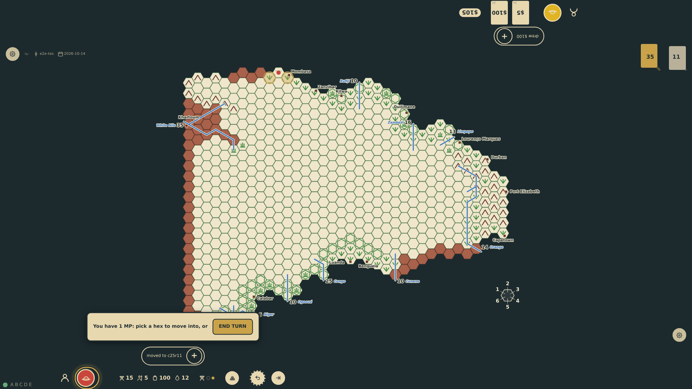
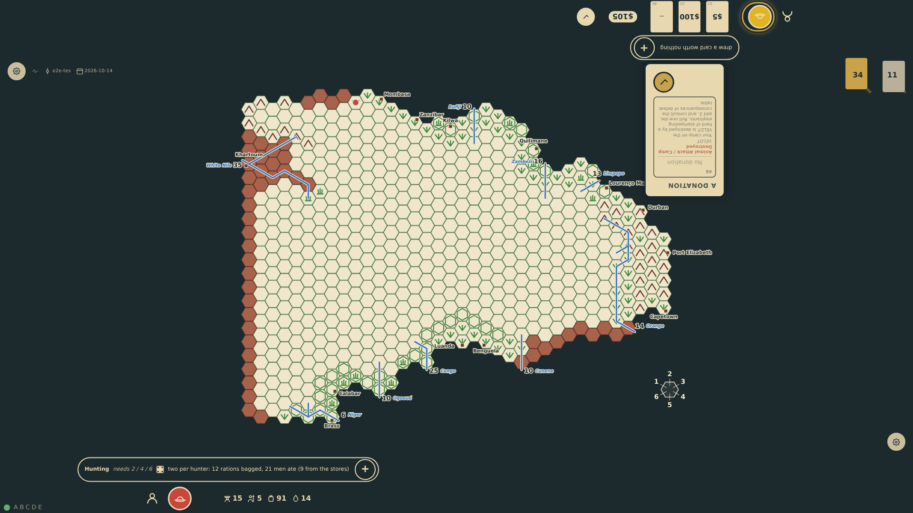

# Out of moves

An expedition in the field with no move left has nothing more to do in its turn but hunt and eat. The table no longer waits for the end-turn control then (prompt 70): the step that spends the last movement point ends the turn, the hunting die is rolled and the next seat plays. While a move is left the turn stays open as before, and so it does at a port, in Europe, and after an undo. The scenarios before this one run with the rule off (the E2E build's default) and end their turns by the control; this one switches it on with ?auto-end=1, as the table has it.

_Generated by the test step helper from `046-out-of-moves.spec.ts`. Do not edit by hand._

## 1. On foot the expedition has two movement points: after one step into the known veldt north of Mombasa a move is left, so the turn stays bottom-1's, the board offers the next step and the end-turn control stands at the rail

**Player**

**Verifications:**

- [x] It is still bottom-1's turn with targets on the board and the end-turn control at the rail; no turn has ended since the step
- [x] The turn's record at the seat's edge prompts for the step with the point left, or END TURN, and stands clear of the hexes it may step into (prompt 74)

## 2. The second step spends the last point, and without a tap on the end-turn control the turn is over: the hunting die is rolled (a 4), the men eat, and it is top-1's turn

**Player**

**Verifications:**

- [x] The table appended the end of the turn right after the step; the hunt's die and meal stand at bottom-1's rail and the top seat is to play
