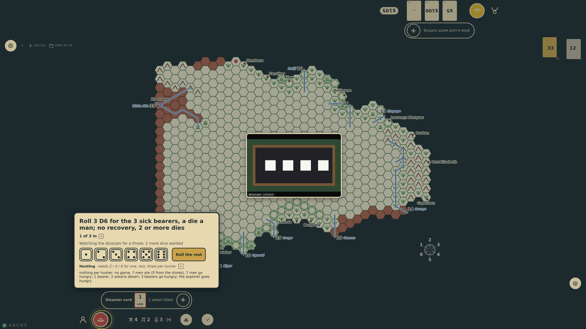
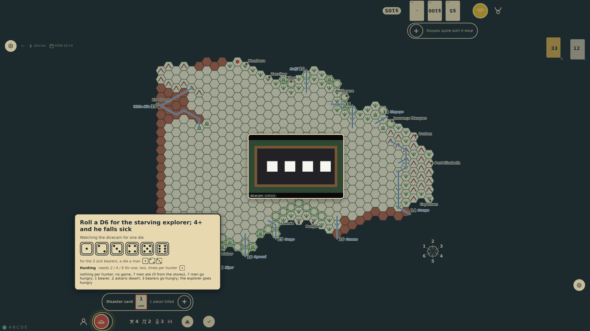
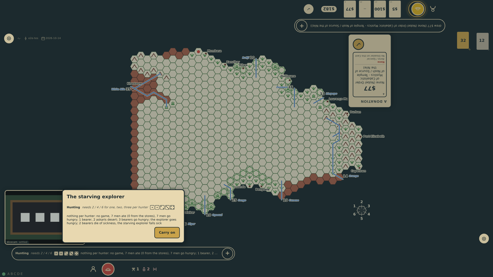

# Sickness dice

Every sick man rolls a die each evening. With physical dice the table does not ask for them a man at a time: it asks once for a type of man, "Roll 3 D6 for the 3 sick bearers, a die a man", then for the sick askaris, and the dice of an ask may come as the player likes, a bunch at a throw or one by one, the panel counting them in (prompt 75). A single sick man is still one die.

_Generated by the test step helper from `047-sickness-dice.spec.ts`. Do not edit by hand._

## 1. The turn ends with three sick bearers and nothing to eat. The hunt is in, and the table asks once for the three sick bearers: three dice, a die a man, to come as the player likes

**Player**

**Verifications:**

- [x] One ask for three dice names the three sick bearers and what a die means; none is in yet

## 2. One die is thrown by itself, a 1: the table takes it as the first bearer's and waits for the other two

**Player**

**Verifications:**

- [x] The panel counts one of three in, and the same ask stands

## 3. The other two dice, a 2 and a 3, complete the bearers' throw. The starving explorer is one man and one die, asked for as before

**Player**

**Verifications:**

- [x] The ask is a single die for the starving explorer, the bearers' three dice read back in order

## 4. A 4 for the explorer, who falls sick. With +3 for starving the bearers' 2 and 3 are deaths and the 1 lingers: the evening ends as it does when the table rolls

**Player**

**Verifications:**

- [x] Two bearers are dead, one bearer and the explorer are sick, and the meal's line holds every die in order
