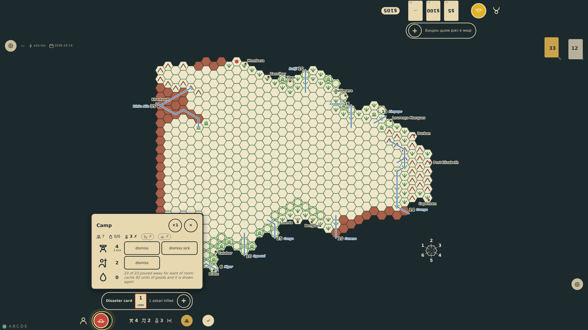
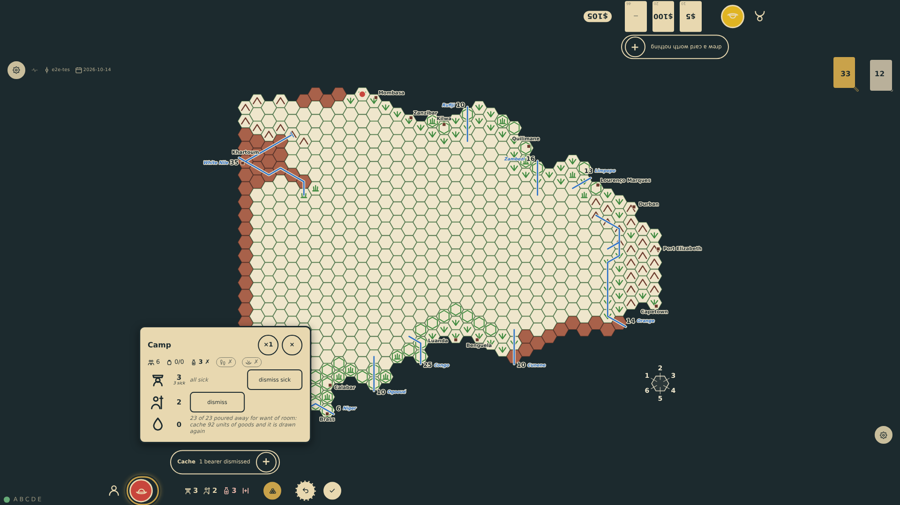
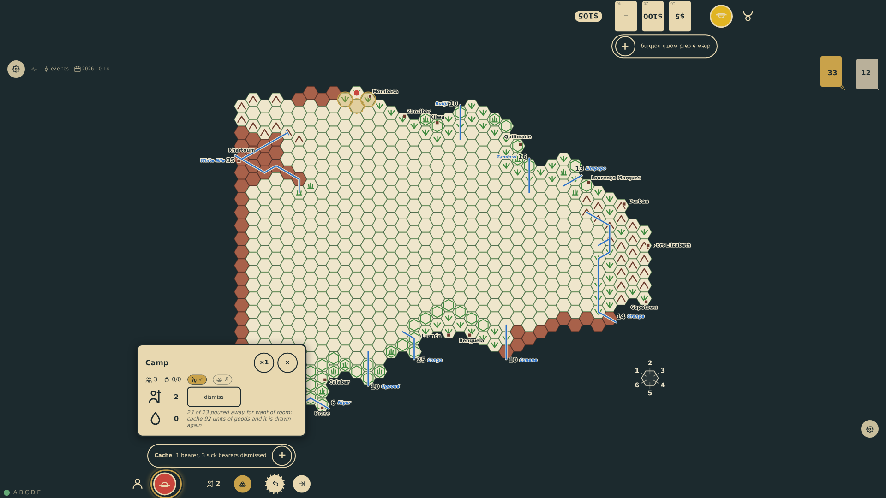

# The camp with sick men

The camp panel remembers who is sick (prompt 76). A type of man with sick among it shows how many ("4", "3 sick"); the line that says how the expedition could move counts as the board does, a sick bearer carrying nothing and every sick man twenty units of what is carried, and says when the sick cannot all be carried. Dismiss sends the well away; a second control, dismiss sick, sends the sick, and the sick count goes down with them.

_Generated by the test step helper from `048-camp-with-sick-men.spec.ts`. Do not edit by hand._

## 1. Halted with three sick bearers of four, the camp is opened: the bearers' row says 4 and 3 sick, with a control for the well and one for the sick; the line above counts the sick and says nothing can move

**Player**

**Verifications:**

- [x] The bearers' row tells the three sick and offers dismiss and dismiss sick; the askaris, none of them sick, have the one control
- [x] The movement line counts three sick, nothing carried and no way to move

## 2. Dismiss sends the well bearer away, not a sick one: three bearers are left, all three sick, and only the sick can be dismissed now

**Player**

**Verifications:**

- [x] Three bearers, three sick; the row says all sick and keeps dismiss sick

## 3. Dismiss sick, three times: the sick bearers are left behind, nobody is sick any more, the halt is lifted and the board offers a step again

**Player**

**Verifications:**

- [x] No bearers and no sick are left; the camp's line in the log tells the well and the sick apart
- [x] The movement line counts no sick, the rail's halt mark is gone and move targets are back
